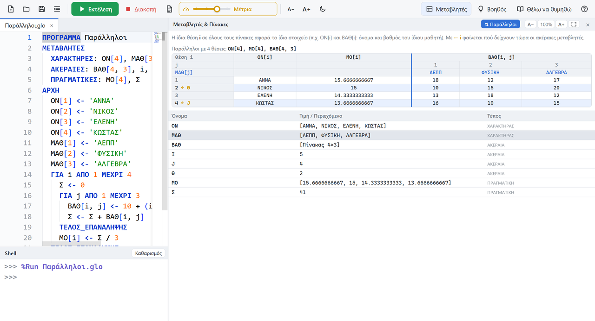
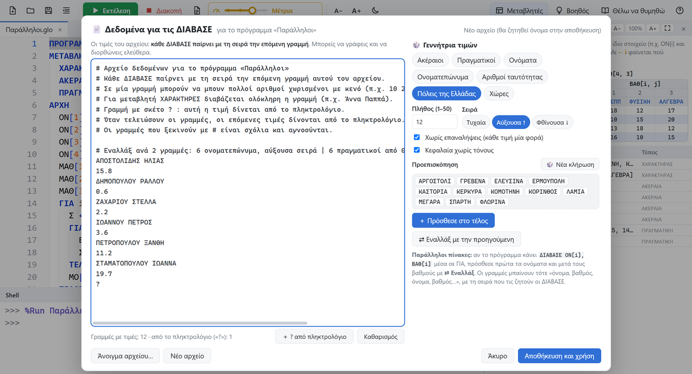

<h1 align="center">myGlossa</h1>

<b>Περιβάλλον προγραμματισμού ΓΛΩΣΣΑΣ για τους μαθητές του Γενικού Λυκείου</b> 
Πληροφορική Γ' Λυκείου / ΑΕΠΠ · Windows και Linux · Δωρεάν (CC BY-NC-SA 4.0)

<a href="https://github.com/pliroforikos/myGlossa-releases/releases/latest"><b>⬇ Λήψη της τελευταίας έκδοσης</b></a> · <a href="docs/INSTALL.md">Οδηγίες εγκατάστασης</a>

---

Το **myGlossa** είναι ένα περιβάλλον τύπου Thonny, φτιαγμένο για να **μαθαίνει ο μαθητής**. Εκτελεί τη ΓΛΩΣΣΑ ακριβώς όπως την ορίζει το σχολικό βιβλίο. Όταν κάτι πάει στραβά, εξηγεί στα ελληνικά **τι έγινε, γιατί και πώς διορθώνεται**. Δεν χρειάζεται καμία άλλη εγκατάσταση: ο διερμηνευτής της ΓΛΩΣΣΑΣ είναι ενσωματωμένος.

Αυτό το αποθετήριο περιέχει τις **εκδόσεις** (εκτελέσιμα) και τις **οδηγίες εγκατάστασης**.

> Έως την έκδοση 1.0.1 η εφαρμογή λεγόταν **myGlossomatheia**. Η νέα έκδοση την αντικαθιστά αυτόματα και κρατά τις ρυθμίσεις της.

## ⬇ Λήψη

Από τη σελίδα **[Releases](https://github.com/pliroforikos/myGlossa-releases/releases/latest)** διάλεξε το αρχείο για τον υπολογιστή σου:

| Αρχείο | Για | Εγκατάσταση |
|---|---|---|
| `myGlossa-<έκδοση>-setup.exe` | Windows 10 / 11 | Άνοιξέ το και ακολούθησε τα βήματα (**προτείνεται**). |
| `myGlossa-<έκδοση>-portable.exe` | Windows 10 / 11 | Χωρίς εγκατάσταση: απλώς άνοιξέ το (π.χ. από USB). |
| `myglossa_<έκδοση>_amd64.deb` | Ubuntu, Linux Mint, Debian | `sudo apt install ./myglossa_<έκδοση>_amd64.deb` |
| `myGlossa-<έκδοση>-linux-x64.tar.gz` | Linux (64-bit) | `tar xzf …` και `./myglossa.sh` |
| `myGlossa-<έκδοση>-ia32-setup.exe` | Windows 10 (**32-bit**) | Άνοιξέ το και ακολούθησε τα βήματα. |
| `myGlossa-<έκδοση>-ia32-portable.exe` | Windows 10 (**32-bit**) | Χωρίς εγκατάσταση, για 32-bit Windows 10. |

Αν δεν ξέρεις αν ο υπολογιστής σου είναι 32-bit ή 64-bit: Ρυθμίσεις → Σύστημα → Πληροφορίες → «Τύπος συστήματος».

Στα Windows, αν εμφανιστεί το μήνυμα **«Τα Windows προστάτευσαν τον υπολογιστή σας»**, πάτα **Περισσότερες πληροφορίες → Εκτέλεση οπωσδήποτε**. Το μήνυμα εμφανίζεται επειδή το πρόγραμμα δεν έχει εμπορική ψηφιακή υπογραφή.

📖 Αναλυτικά, μαζί με τη λειτουργία «Τάξη» για το εργαστήριο: **[docs/INSTALL.md](docs/INSTALL.md)**

## 🌟 Τι προσφέρει

**Η ΓΛΩΣΣΑ του βιβλίου**
- Ενσωματωμένος διερμηνευτής με τους κανόνες του βιβλίου:
  - αυστηροί τύποι, σταθερές, πίνακες 1Δ/2Δ, ΔΙΑΔΙΚΑΣΙΕΣ και ΣΥΝΑΡΤΗΣΕΙΣ·
  - DIV/MOD μόνο για θετικούς ακέραιους, Α_Μ με το ακέραιο μέρος προς τα κάτω·
  - τριγωνομετρικές συναρτήσεις σε μοίρες.
- **Μηνύματα λαθών που διδάσκουν**, στα ελληνικά, με τον κανόνα και τη διόρθωση. Προτείνει και τη σωστή λέξη σε ορθογραφικά λάθη (π.χ. «ΑΕΡΑΙΕΣ» → «ΑΚΕΡΑΙΕΣ»).
- Έλεγχος καθώς γράφεις, με συμβουλές. Τα λάθη σημειώνονται στη γραμμή όπου βρίσκονται.
- **Έλεγχος ονομάτων σε πραγματικό χρόνο:** όνομα που δεν έχει δηλωθεί υπογραμμίζεται αμέσως, και εντοπίζονται τα **ελληνικά και αγγλικά γράμματα που μοιάζουν** (π.χ. το λατινικό `A` αντί για το ελληνικό `Α`), με εξήγηση ποιο γράμμα είναι από ποιο αλφάβητο.
- **Βοηθός λαθών** με εξήγηση, «τι να δοκιμάσεις» και σωστό παράδειγμα.

**Επεξεργαστής**
- Χρωματισμός και αυτόματη στοίχιση.
- **Αυτόματη συμπλήρωση που καταλαβαίνει πού βρίσκεσαι** (π.χ. μετά το «ΓΙΑ i» προτείνει «ΑΠΟ»).
- **Μορφοποίηση κώδικα** με ένα κλικ.
- Σκελετός νέου προγράμματος.

**Εκτέλεση και παρακολούθηση**
- **Βήμα-βήμα** με ρύθμιση ταχύτητας και φωτισμό της γραμμής που εκτελείται.
- **Μεταβλητές & Πίνακες** με ζωντανές τιμές.
- **⇅ Παράλληλοι πίνακες** δίπλα-δίπλα, μαζί και με δισδιάστατους, με δείκτες «← i».

**📄 Δεδομένα για τις ΔΙΑΒΑΣΕ**
- Οι τιμές γράφονται μία φορά σε αρχείο, όχι σε κάθε εκτέλεση.
- **Γεννήτρια τιμών:** αριθμοί, ονόματα, ονοματεπώνυμα, αριθμοί ταυτότητας, πόλεις, χώρες, σε τυχαία, αύξουσα ή φθίνουσα σειρά.
- **«Εναλλάξ»** για παράλληλους πίνακες.
- Γραμμή `?` για τιμές από το πληκτρολόγιο.

**Μάθηση και τάξη**
- **«Θέλω να θυμηθώ»:** εντολές και τεχνικές της ύλης (αθροίσματα, μέγιστα, αναζητήσεις, ταξινομήσεις, συγχωνεύσεις, 2Δ και παράλληλοι πίνακες, στοίβα, ουρά, υποπρογράμματα), με σήμανση θεμάτων Πανελλαδικών.
- **Μεγάλα γράμματα και πλήρης οθόνη** σε κάθε πλαϊνή καρτέλα, για προβολή στον πίνακα.
- **Τάξη:**
  - ο καθηγητής βλέπει ζωντανά τον κώδικα των μαθητών και ποιος «σηκώνει χέρι» ✋·
  - παρουσιάζει τον δικό του κώδικα σε όλους·
  - όλα γίνονται στο τοπικό δίκτυο, κρυπτογραφημένα, χωρίς internet.

Συνυπάρχει στο ίδιο εργαστήριο με το [myPython2](https://github.com/pliroforikos/myPython2) και το [EduPython3](https://github.com/pliroforikos/EduPython3) (άλλες θύρες, άλλοι φάκελοι).

## 📄 Άδεια

© 2026 **Λέων Προκόπης**, καθηγητής Πληροφορικής ΠΕ86.

Άδεια [**CC BY-NC-SA 4.0**](LICENSE): ελεύθερη χρήση, αντιγραφή και διανομή για μη εμπορικούς σκοπούς, με αναφορά στον δημιουργό και με την ίδια άδεια.
